<h1 align="center">Invoice Ninja for WordPress</h1>

  <strong>Sell your Invoice Ninja products on your WordPress site, give customers an account for their invoices, take quote requests and subscriptions, or invoice every WooCommerce order.</strong>

  <a href="#getting-started">Getting started</a> ·
  <a href="#selling-online">Selling</a> ·
  <a href="#the-checkout">Checkout</a> ·
  <a href="#orders">Orders</a> ·
  <a href="#the-customer-account">Account</a> ·
  <a href="#quote-requests">Quotes</a> ·
  <a href="#subscriptions">Subscriptions</a> ·
  <a href="#woocommerce">WooCommerce</a> ·
  <a href="#status-and-troubleshooting">Status</a> ·
  <a href="#faq">FAQ</a>

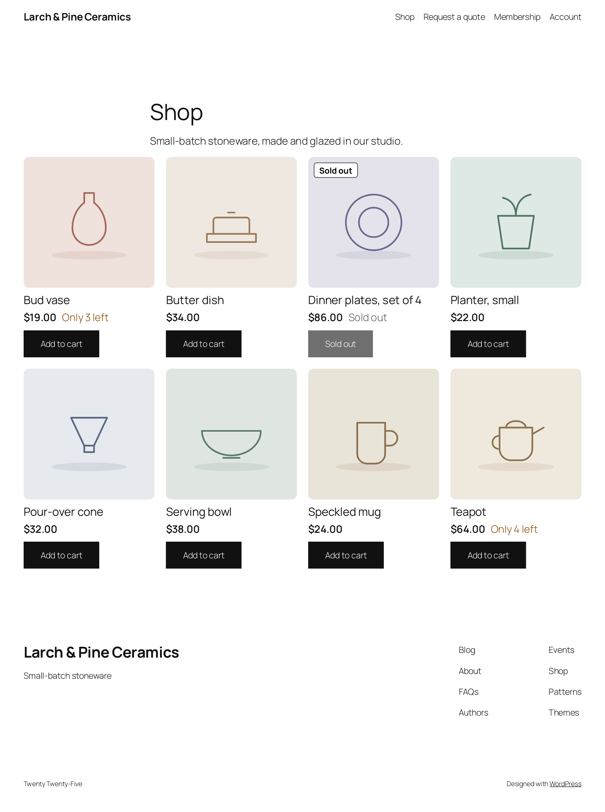

[Invoice Ninja](https://invoiceninja.com) is open-source invoicing, either hosted at [invoicing.co](https://invoicing.co) or self-hosted. This plugin connects it to WordPress:

- **Your products, prices and stock come from Invoice Ninja.** Change them there and the site updates by itself.
- **Every order becomes an invoice in Invoice Ninja**, and customers pay on Invoice Ninja's secure payment page with the gateway you already use, whether that's Stripe, PayPal or any of the others.
- **Customers get an Account page on your site** with their invoices, quotes, payments, credits and subscriptions.
- **Nothing is lost when something goes wrong.** If Invoice Ninja is slow or down, orders are saved and sent later, and never twice.

| What you can do | How |
|---|---|
| Sell products with a cart and guest checkout | [Store blocks](#selling-online) |
| Give customers their invoices, PDFs and payment links | [Account block](#the-customer-account) |
| Let people pay an invoice by number | [Pay Invoice block](#pay-an-invoice) |
| Take quote requests that become draft quotes | [Quote Request Form](#quote-requests) |
| Sell plans with recurring billing | [Pricing Table and Subscribe Button](#subscriptions) |
| Invoice every WooCommerce order | [WooCommerce module](#woocommerce) |

---

## Getting started

### What you need

- WordPress 6.7 or newer, and PHP 8.1 or newer.
- An Invoice Ninja account:
  - **Hosted** (invoicing.co): a **Pro or Enterprise** plan.
  - **Self-hosted:** any plan, including the free one.
- An **API token** from an Invoice Ninja admin. To create one, open Invoice Ninja → **Settings → Account Management → API Tokens → New Token**. Each company has its own tokens.

### Setup

Install and activate the plugin, then open **Invoice Ninja** in the WordPress admin menu. Setup takes about five minutes:

1. **Where your Invoice Ninja is.** Choose hosted, or enter your self-hosted address.
2. **Your API token.** The plugin tests it straight away:
   - **checked:** the server, the security certificate, the token, admin rights, the version, and webhooks;
   - **if something's wrong**, you get a plain-language reason and the fix.
3. **Your company.** Confirm the name, logo and product count.
4. **WooCommerce.** If WooCommerce is active, choose whether it runs your store.
5. **Features.** Pick the store, customer account, quote form or subscriptions.
6. **Email.** Send a test email to make sure checkout emails arrive.

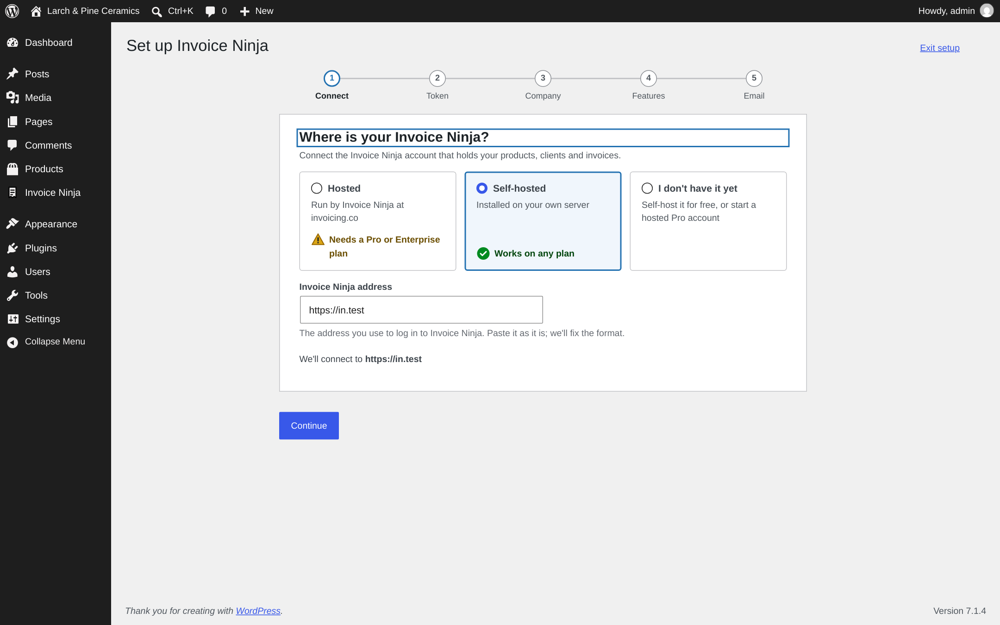

### Home

**Invoice Ninja → Home** shows how the shop is doing:
- orders in the last 30 days, what's been paid, what's waiting for payment, and anything that needs you;
- your latest orders;
- a checklist of what's left to set up;
- switches to turn each feature on or off.

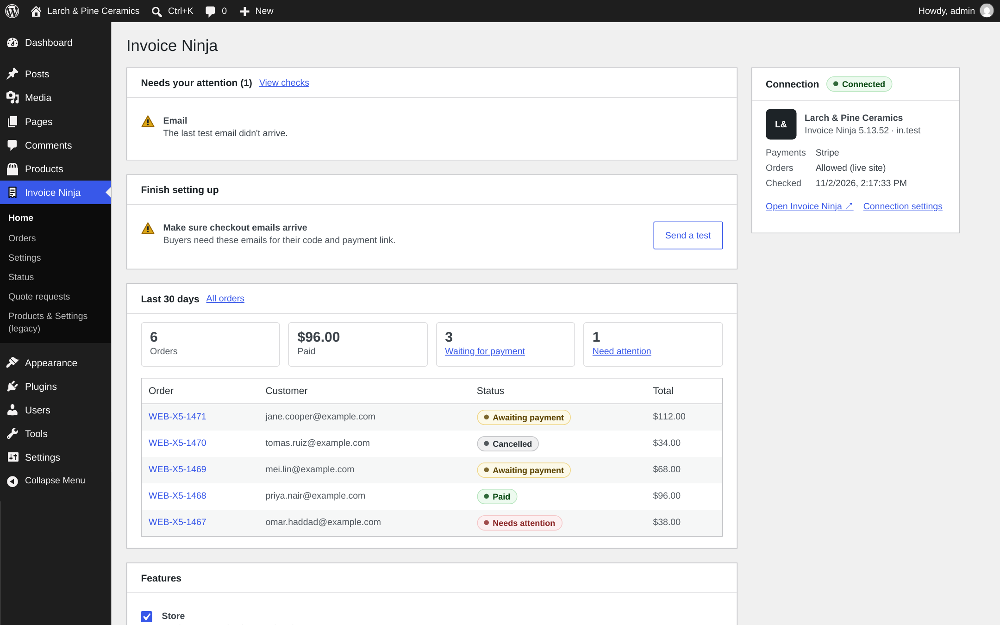

---

## Selling online

Turn on **Store**. Then open **Settings → Store** and click **Create missing pages**: it makes a **Shop**, a **Checkout** and an **Order Status** page. Edit them like any other page, or add the blocks wherever you like.

### Products

Products sync from Invoice Ninja every hour, and on demand from **Status → Tools → Sync now**. Each product gets its own page on your site, with its name, description, price, image and stock. Products are updated in place: links never change, and an outage never removes anything.

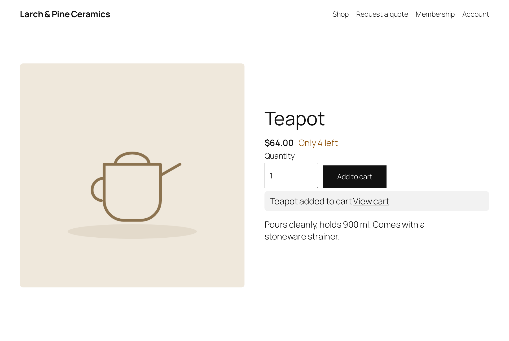

### The store blocks

All the blocks are in the **Invoice Ninja** category of the block inserter. They use your theme's fonts, colours and buttons.

| Block | What it shows | Shortcode |
|---|---|---|
| **Products** | A grid of products: choose columns, sort order, sold-out handling and what to show | `[invoiceninja_products columns="3"]` |
| **Product** | One product's price, stock and Add to cart; **Product Price** and **Product Stock** show just one part | `[invoiceninja_product product_id="…"]` |
| **Add to Cart Button** | A button for one product, anywhere | `[invoiceninja_add_to_cart product_id="…"]` |
| **Mini Cart** | A cart button with the item count, for your header | `[invoiceninja_mini_cart]` |
| **Checkout** | The cart, the customer's details, the email code and the payment link | `[invoiceninja_checkout_form]` |
| **Order Status** | An order's status, opened from the link in the order email | `[invoiceninja_order_status]` |

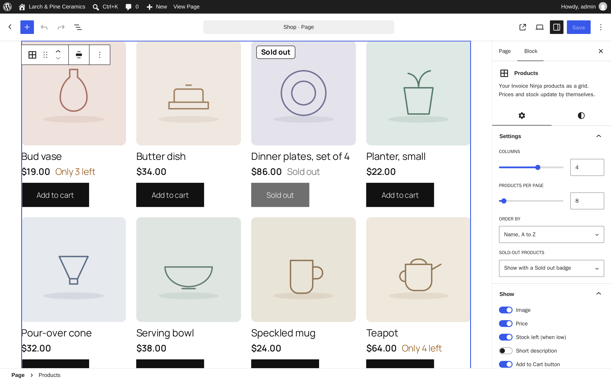

### Store settings

**Settings → Store**:

| Setting | Options |
|---|---|
| **Online ordering** | **Cart** (several products, then checkout), **Buy Now** (one product, straight to checkout), or **Off** (prices only) |
| **Who can order** | Guests, who confirm their email with a code, or require customers to log in |
| **Display** | **Blocks**, the new store, or **Legacy 1.x**, which keeps a 1.x site looking exactly as before |
| **Store pages** | Create or check the Shop, Checkout and Order Status pages |
| **Unpaid orders** | Optionally cancel invoices that stay unpaid for N days. Off by default; anything with a payment is never touched |

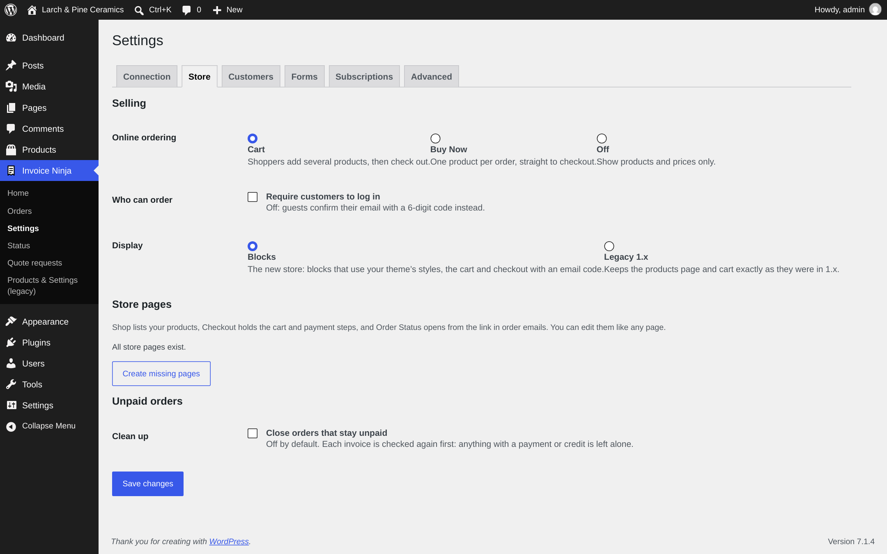

Stock limits come from Invoice Ninja's **Track inventory** setting. Stock is checked live just before checkout, so nobody buys the last item twice.

---

## The checkout

The checkout is built for people who just want to pay.

**1. The cart.** Change quantities or remove items, and see the subtotal. Tax is added on the payment page, from your Invoice Ninja tax settings.

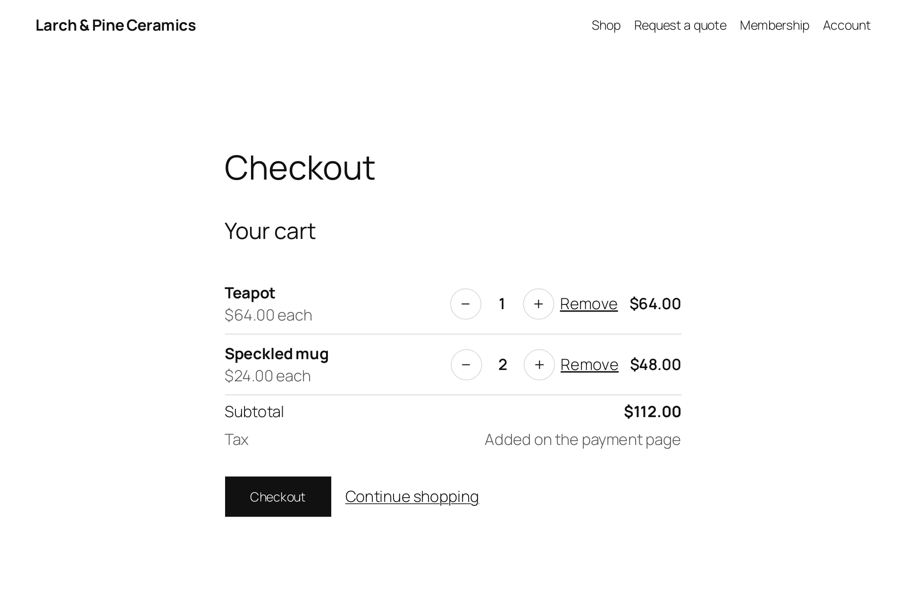

**2. The customer's details.** Email and name. Customers who are logged in and have confirmed their email skip straight ahead.

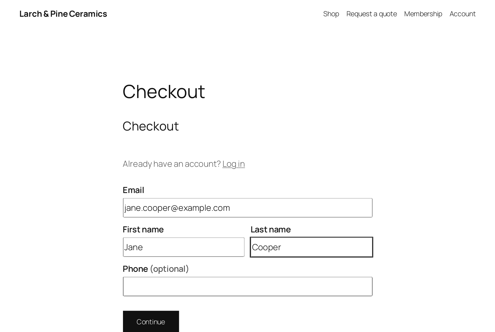

**3. A 6-digit code from their email.** This confirms the email belongs to them, so invoices and payment links only ever reach the owner of the address:
- the order is placed as soon as the 6th digit is typed or pasted;
- **Remember this device** skips the code for 30 days;
- nothing is created in Invoice Ninja until the code is right.

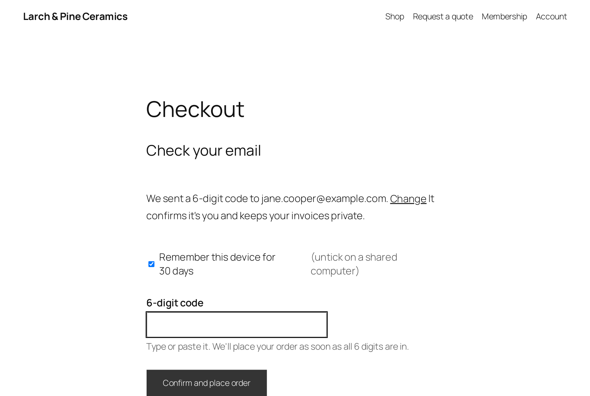

**4. Pay.** The order becomes an invoice in Invoice Ninja, and the customer continues to its secure payment page. They also get an email with the payment link and a link to their order.

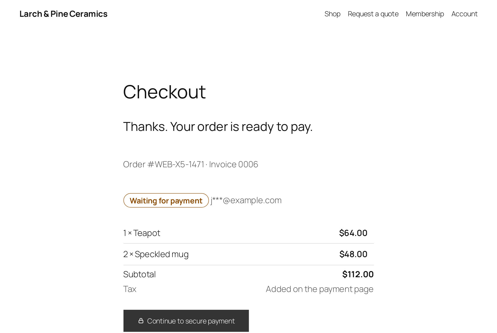

**Order Status.** The link in the order email opens the order: what's paid, the items, and a **Pay** button while it's unpaid. Lost the email? **Find my order** sends a fresh link.

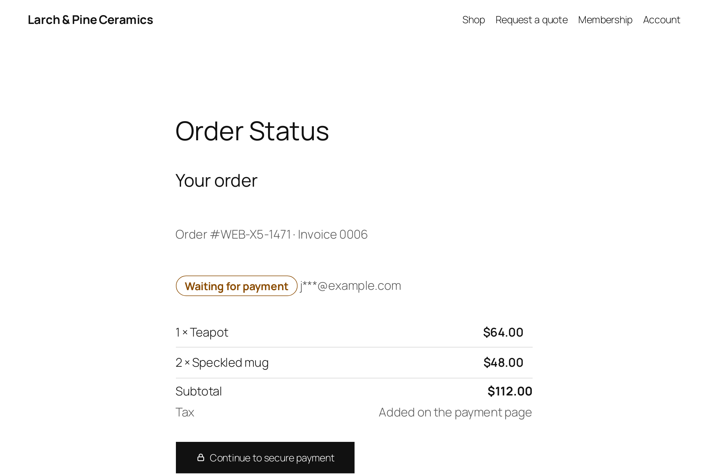

Customers who leave the payment page without paying see their unpaid order when they come back to Checkout. They can **continue to payment**, or **change the order**, which cancels it and puts the items back in their cart.

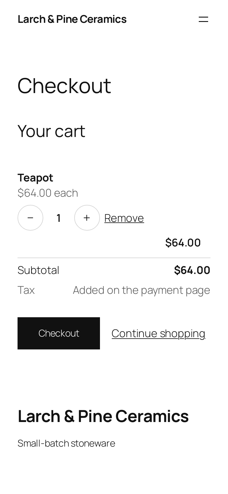

**What happens when things go wrong**
- **Invoice Ninja is down at checkout:** the order is saved, the customer is told their payment link is on its way, and it's sent once Invoice Ninja is back.
- **A staging copy of your site:** a copy at a new address pauses orders until you allow them, so testing never creates real invoices.
- **No payment gateway in Invoice Ninja:** orders still arrive, and you're warned that customers can't pay online yet.

---

## Orders

**Invoice Ninja → Orders** lists every order from your site's checkout.

| Status | Meaning |
|---|---|
| Queued | Saved, waiting to reach Invoice Ninja (for example while it's down) |
| Awaiting payment | The invoice was created and sent to the customer |
| Paid | Invoice Ninja recorded the payment |
| Cancelled | Cancelled here, or by the customer with Change order |
| Needs attention | Couldn't be sent to Invoice Ninja; the note says why and what to do |

Row actions:
- resend the payment email;
- retry an order that needs attention;
- copy the customer's status link;
- open the invoice or client in Invoice Ninja;
- cancel, which also cancels the invoice in Invoice Ninja and can email the customer.

There are also bulk actions, search and a month filter.

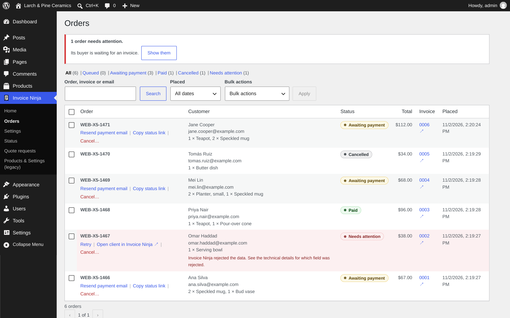

Invoice Ninja already emails you about invoices and payments. You can also choose an email for every new order, or a weekly summary, under **Settings → Advanced**.

---

## The customer account

Turn on **Customer account**. Then go to **Settings → Customers → Create the Account page**, or add the **Account** block anywhere. Customers see their **Invoices, Quotes, Payments, Credits and Subscriptions** from Invoice Ninja, with **Pay**, **View** and **PDF** links.

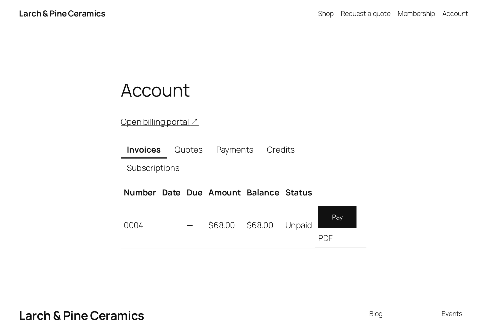

- **Confirmed emails only.** The first time, customers confirm their email with a 6-digit code. Until then, no invoices or links are shown.
- **Links stay private.** Portal and payment links are never written into your pages. Each link goes through your site, which checks the visitor first, so cached pages can't leak them.
- **Portal Link.** The Portal Link block (or `[invoiceninja_client_portal_url]` for menus and page builders) opens the customer's Invoice Ninja billing portal, as a link or a button.

**Settings → Customers** decides when WordPress users become Invoice Ninja clients:
- when they buy (the default), or as soon as they register;
- which roles count;
- you can export existing users in the background;
- you can mark a whole role as confirmed when their emails were already checked.

Each user's profile shows their link and whether their email is confirmed.

### Pay an invoice

The **Pay Invoice** block lets anyone pay an invoice by its number. They enter the number and their email, and the payment link is emailed to them. The reply never reveals whether an invoice exists.

---

## Quote requests

Turn on **Quote Request Form** and add the block to a page.

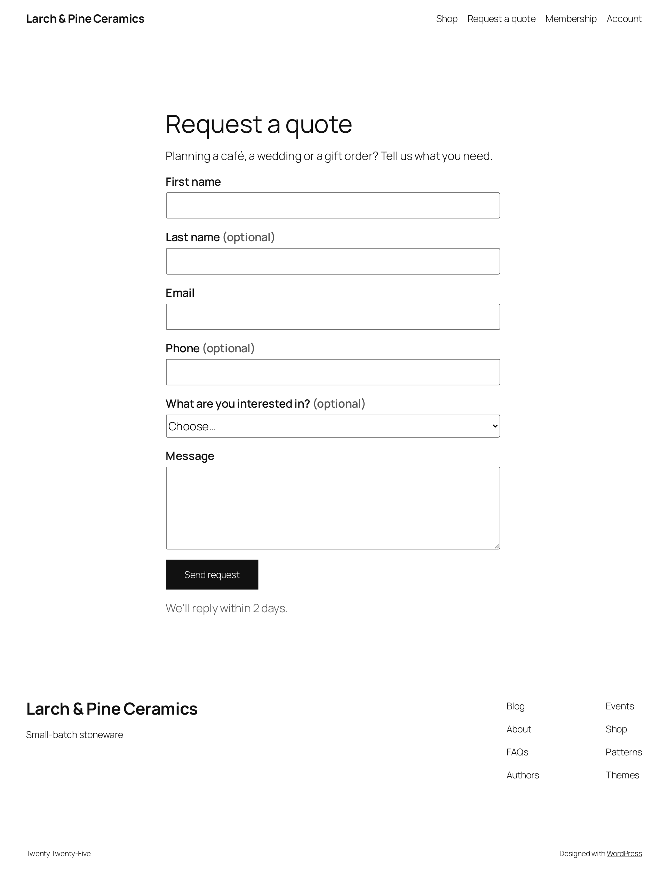

**The form**
- Fields: name, email, phone, a product (from the ones you choose, plus "Not sure yet") and a message.
- Each field can be required or optional.
- Privacy and Terms checkboxes link to your pages.

**What happens with each request**
- It becomes a **draft quote** in Invoice Ninja, with the product as a line item and your tags. Existing clients are matched by email and never changed.
- If Invoice Ninja is down, requests are queued and sent later.
- Spam protection is built in: a hidden field, a minimum time to fill the form, rate limits, Akismet, and a CAPTCHA hook.
- You get an email for each request, or a daily digest, and the requester can get an auto-reply.

**Invoice Ninja → Quote requests** shows each request, its quote status in Invoice Ninja (draft, sent or approved), and Retry for any that failed.

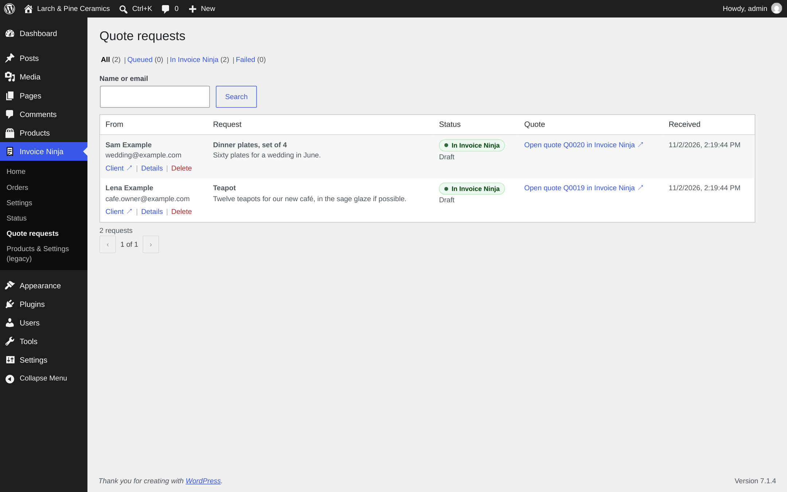

---

## Subscriptions

Turn on **Subscriptions** to sell the subscriptions you set up in Invoice Ninja.

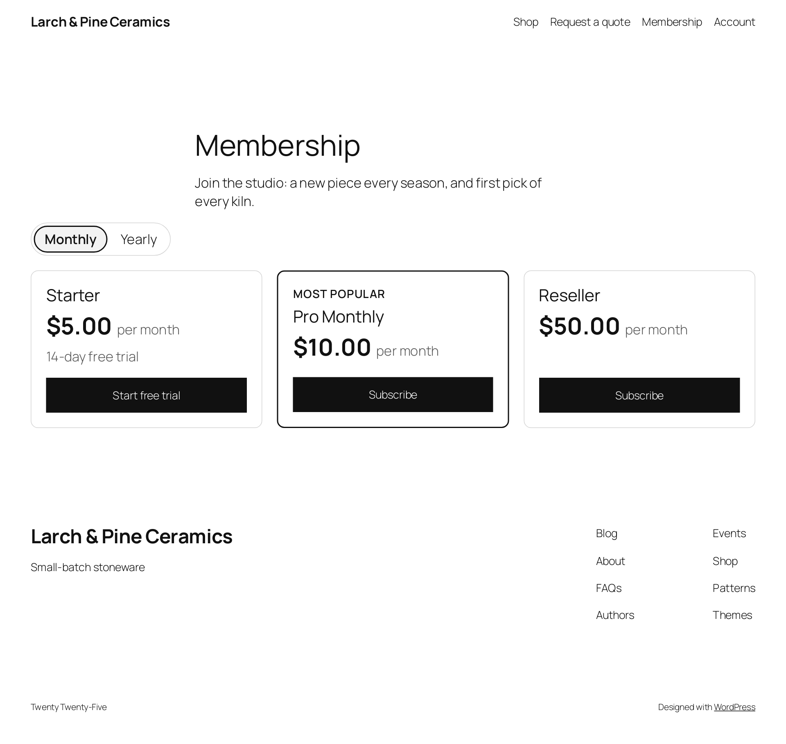

- **Pricing Table:** your plans side by side, with a monthly/yearly switch when you pair plans.
- **Subscribe Button:** a single plan anywhere.
- **Buying:**
  - Logged-in customers who have confirmed their email land on Invoice Ninja's purchase page already signed in.
  - Guests get the form pre-filled.
- **Account:** the Subscriptions tab shows each plan's status and next bill, with links to change plan, update the payment method or cancel.
- **Automation:** connect a subscription in **Settings → Subscriptions** and your site hears about every purchase, renewal, plan change, cancellation and overdue payment. Use it to provision a hosting account or a membership:
  - with WordPress hooks;
  - or with a signed web request to your own system. [Hosting recipe →](docs/hosting.md)

---

## WooCommerce

With **WooCommerce invoicing** on, WooCommerce stays your store and Invoice Ninja becomes the ledger. The plugin's own cart and checkout step aside.

- **Invoices:** every order becomes an invoice: products, shipping, fees, discounts and taxes, reconciled to the order total.
- **Payments:** a payment is recorded when the order is paid. Cash on delivery counts only once the order is completed.
- **Refunds and cancellations:** refunds are mirrored, and cancelled or failed orders cancel their invoice.
- **No duplicates:** never a duplicate invoice or payment, even when a retry happens.
- **On the order screen:** a panel shows the invoice, its status and Retry. It works with and without HPOS.
- **For customers:** an **Invoices & billing** tab in My Account, and the invoice link in their order emails.
- **Older orders:** backfill them from **Settings → WooCommerce** or WP-CLI, with a dry run first.

---

## Status and troubleshooting

**Invoice Ninja → Status** has three tabs.

**Checks** tests everything:
- the connection, the token and its admin rights;
- the Invoice Ninja version, webhooks, gateways and the portal password;
- your site's scheduled tasks, database and email;
- whether this copy of your site is allowed to take orders.

Each problem comes with a plain explanation and a fix, and **Fix problems** repairs what it safely can. The same checks appear in **Tools → Site Health**.

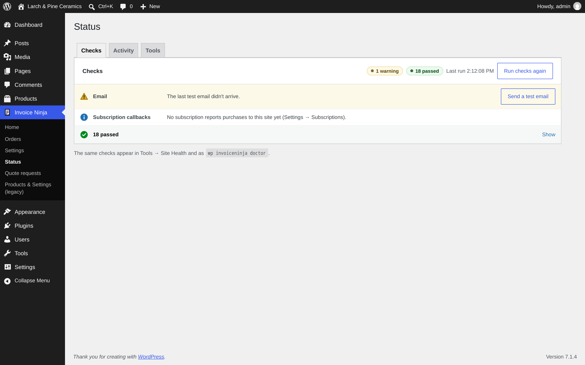

**Activity** is a log of what happened: syncs, orders, emails and errors. Emails and links are masked, and tokens are never written to it.

**Tools** lets you sync products, refresh company details, and pause or allow orders.

For developers: `wp invoiceninja status`, `wp invoiceninja doctor --repair`, and more in the [developer guide](docs/developers.md).

---

## Upgrading from 1.x

Updating from any 1.x version is automatic, and nothing from 1.x is deleted.

- **Your shop looks and works the same.** The 1.x products page and cart stay, in the Legacy 1.x display.
- **Your settings carry over:** the token (now encrypted), purchase mode, login requirement, templates and CSS.
- **Carts in progress during the update are emptied.** Shoppers just add their items again.

After the update, the **Welcome to 2.0** screen explains what changed. From there you can **Preview with blocks** (a draft copy of your Shop page), then **Switch to blocks**, and switch back any time in Settings → Store.

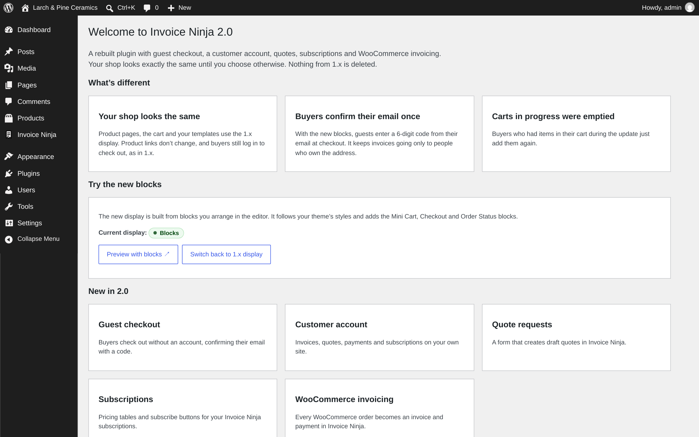

If you ever need to roll back, use 1.0.16, not an earlier 1.x.

---

## FAQ

**Do I need a paid Invoice Ninja plan?** 
Hosted Invoice Ninja needs Pro or Enterprise to connect. Self-hosted works on any plan.

**Where do customers pay?** 
On Invoice Ninja's payment page, using the gateways you set up there. The plugin never sees card details.

**Does it work with page caching?** 
Yes. Pages stay cacheable: the cart, checkout and account load after the page renders, and the cart cookie doesn't start with `wp-`.

**Does it slow down my site?** 
No. Nothing is added to pages that don't use the blocks, and the slow work runs in the background.

**Can I change how it looks?** 
The blocks follow your theme. Spacing and corners are CSS custom properties, and each block supports `theme.json`. See the [developer guide](docs/developers.md#theming).

**Is my data safe?** 
Your API token is encrypted. Personal data can be exported and erased under **Tools → Export/Erase Personal Data**, and there's suggested text for your privacy policy.

**Something isn't working.** 
Open **Status → Checks**. Most problems come with a one-click fix. You can also [open an issue](https://github.com/invoiceninja/wordpress/issues).

---

  <a href="docs/developers.md">Developer guide</a> ·
  <a href="docs/hosting.md">Subscriptions hosting recipe</a> ·
  <a href="https://invoiceninja.com/terms/">Terms</a> ·
  <a href="https://invoiceninja.com/privacy-policy/">Privacy</a>

